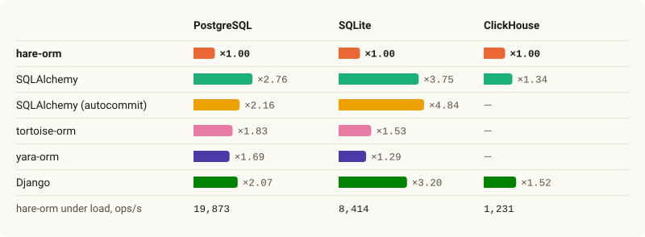

<h1 align="center">
  <picture>
    <source media="(prefers-color-scheme: dark)" srcset="docs/assets/readme-banner-dark.png">
    
  </picture>
</h1>

<p align="center"><a href="README.ru.md">Русский</a></p>

<p align="center">
  <a href="https://github.com/hare-orm/hare-orm/actions/workflows/ci.yml"></a>
  <a href="https://hare-orm.github.io/hare-orm/"></a>
  <a href="LICENSE"></a>
  <a href="pyproject.toml"></a>
</p>

An async Python ORM for PostgreSQL, SQLite and ClickHouse, built with relations in mind. Models are
plain classes, queries are built lazily through a `QuerySet`, and migrations are generated from the
changes to the models. Coming from Django? See [Coming from Django](https://hare-orm.github.io/hare-orm/getting-started/coming-from-django/).

- **Fast.** A Rust PostgreSQL driver decodes rows and converts values outside Python, and every
  query shape is built once: a repeated query only binds its new values — see
  [Benchmarks](#benchmarks).
- **Relations done right.** Composite primary keys everywhere — as foreign-key targets too — generic
  relations made of real foreign keys, `select_related()`/`prefetch_related()` with filters, recursive
  queries over a tree, and an error instead of a silently inflated aggregate — see
  [Models and relations](https://hare-orm.github.io/hare-orm/#models-and-relations).
- **Your schema, declared.** Constraints, partial and expression indexes, triggers, views,
  materialized views, functions, sequences, row level security policies, grants and partitioning
  live in the model's `Meta` and are created and changed by migrations — see
  [The schema in `Meta`](https://hare-orm.github.io/hare-orm/#schema-in-meta).
- **Application patterns built in.** Soft delete, versioned rows, multi-tenancy (by column, by
  schema or by row level security), optimistic locking, dirty-field tracking and a transactional
  outbox are `Meta` options — see [Behavior declared in `Meta`](https://hare-orm.github.io/hare-orm/#behavior-in-meta).
- **Migrations you can trust.** Detected from the models, checked for operations that lock a busy
  table, compared with the live database (`hare drift`), and generated from an existing database
  (`hare inspectdb`) — see [Migrations](https://hare-orm.github.io/hare-orm/#migrations).
- **Every database on its own terms.** SQLite, PostgreSQL and ClickHouse are dialects built on the
  public API a third-party package uses; PostgreSQL's types, indexes, PostGIS, pgvector, full-text
  search and `LISTEN`/`NOTIFY` come with it, and a database lacking a feature raises a clear error
  instead of returning a wrong result — see [Databases](https://hare-orm.github.io/hare-orm/#databases).
- **Ready for production.** Observers, OpenTelemetry, SQL comment tags, an N+1 detector, pool
  metrics, distributed transactions, read replicas and routers, PgBouncer support, Pydantic schemas
  and Litestar, FastAPI and Robyn integrations — see [Observability](https://hare-orm.github.io/hare-orm/#observability).
- **Checked before it runs.** A mypy plugin rejects a misspelled filter and types the rows of
  `values()`; a pytest plugin, factories and query-count assertions cover the tests — see
  [Testing and type checking](https://hare-orm.github.io/hare-orm/#testing-and-type-checking).

The full tour, area by area, is on the [documentation's home page](https://hare-orm.github.io/hare-orm/).

## Contents

- [Quick start](#quick-start)
- [Installation](#installation)
- [Benchmarks](#benchmarks)
- [Documentation](#documentation)
- [Versioning and releases](#versioning-and-releases)
- [Contributing](#contributing)
- [License](#license)

## Quick start

```bash
pip install hare-orm
```

```python
# library/models.py
from hare import fields
from hare.models import Model


class Author(Model):
    id = fields.IntField(primary_key=True)
    name = fields.CharField(max_length=120)


class Book(Model):
    id = fields.IntField(primary_key=True)
    author = fields.ForeignKeyField("models.Author", related_name="books")
    title = fields.CharField(max_length=300)
    rating = fields.IntField(default=0)
```

```python
# main.py
import asyncio

from hare import Hare, HareConfig
from library.models import Author, Book


async def main() -> None:
    await Hare.init(HareConfig.from_db_url("sqlite+aiosqlite://db.sqlite3", {"models": ["library.models"]}))
    await Hare.generate_schemas()

    author = await Author.objects.create(name="Ursula K. Le Guin")
    await Book.objects.create(author=author, title="The Left Hand of Darkness", rating=5)

    async for book in Book.objects.filter(author__name__icontains="le guin").select_related("author"):
        print(book.title, "—", book.author.name)

    await Hare.close_connections()


asyncio.run(main())
```

A real project keeps its schema in migrations instead of `generate_schemas()`:
`hare makemigrations`, then `hare migrate`. See
[Your first model](https://hare-orm.github.io/hare-orm/getting-started/first-model/).

## Installation

```bash
pip install hare-orm

pip install hare-orm[asyncpg]        # the pure-Python PostgreSQL driver, instead of the Rust one
pip install hare-orm[clickhouse-connect]  # the ClickHouse dialect over HTTP (clickhouse-connect)
pip install hare-orm[clickhouse-driver]   # the ClickHouse dialect over the native TCP protocol (clickhouse-driver)
pip install hare-orm[sqlite-vec]     # vector search on SQLite
pip install hare-orm[encryption]     # EncryptedTextField / EncryptedJSONField (Fernet)
pip install hare-orm[fastapi]        # also: litestar, robyn, request-query, taskiq
pip install hare-orm[kafka]          # outbox delivery; also: rabbitmq, redis, http
pip install hare-orm[opentelemetry]  # an OpenTelemetry span around every query
pip install hare-orm[pytest]         # the pytest plugin; also: mypy, pyright
pip install hare-orm[ipython]        # `hare shell` with IPython
```

Every extra is listed under
[Installation](https://hare-orm.github.io/hare-orm/getting-started/installation/). Requires Python
3.12, 3.13 or 3.14.

## Benchmarks

<!-- benchmarks:start -->
hare-orm against SQLAlchemy, tortoise-orm, yara-orm and Django on PostgreSQL, SQLite and ClickHouse,
on the same scenarios: how many times slower than hare-orm each ORM is on each database, on average,
and hare-orm's operations per second under load, measured warm — a running application, not one just
started:

<p align="center">
  <picture>
    <source media="(prefers-color-scheme: dark)" srcset="docs/assets/benchmarks/scoreboard-en-dark.svg">
    
  </picture>
</p>

Every scenario, the machine and the versions are on the
[Benchmarks](https://hare-orm.github.io/hare-orm/benchmarks/) pages; the benchmark itself is
[`benchmarks/bench.py`](benchmarks/README.md).
<!-- benchmarks:end -->

## Documentation

**[hare-orm.github.io/hare-orm](https://hare-orm.github.io/hare-orm/)** — the full
reference: every field type, `Meta` option, `QuerySet` method, migration operation, transaction
primitive, dialect feature, PostgreSQL type and index, and the exception hierarchy, in English and
Russian. If you're new to hare-orm, start with
[Getting Started](https://hare-orm.github.io/hare-orm/getting-started/installation/).

To build and browse it locally instead (e.g. to preview an unreleased change):

```bash
poetry install
poetry run mkdocs serve
```

## Versioning and releases

hare-orm follows [Semantic Versioning](https://semver.org/). Its public API is what the
[documentation](https://hare-orm.github.io/hare-orm/) describes; undocumented names and names
with a leading underscore are internal and may change in any release.

Before 1.0.0 the API is still settling:

- a **patch** release (`0.9.1`) only fixes bugs;
- a **minor** release (`0.10.0`) adds features and may change or remove public API. Every such
  change is listed under *Breaking changes* in that release's [CHANGELOG](CHANGELOG.md) entry. A
  renamed or removed name is gone in that same release — hare-orm doesn't keep deprecated aliases.

From 1.0.0 on, breaking changes land only in a major release. Pin the minor version you tested
against (`hare-orm>=0.9,<0.10`) and read the changelog before moving to the next one.

Each release is tagged `vX.Y.Z`, published to [PyPI](https://pypi.org/project/hare-orm/) and to
[GitHub Releases](https://github.com/hare-orm/hare-orm/releases), and described in
[CHANGELOG.md](CHANGELOG.md). Work in progress lives on the `dev` branch; `main` points at the
latest release.

### Supported versions

| Component | Supported |
| --- | --- |
| hare-orm | The latest minor release; fixes ship as its patch releases |
| Python | CPython 3.12, 3.13, 3.14 |
| SQLite | 3.35.5+ |
| PostgreSQL | 14+ |
| PgBouncer | 1.22.1+ |
| ClickHouse | 25.8+ |
| Redis, RabbitMQ, Kafka (outbox) | 7.2+, 4.0+, 3.9+ |

Full support is promised on Linux only: the databases are tested there. On Windows and macOS hare
installs and runs for development — the wheels, the CLI and the tests reading no database are
checked on all three systems.

Dropping a Python or database version is a breaking change and is announced in the changelog.
Security fixes follow [SECURITY.md](SECURITY.md).

## Contributing

Bug reports, feature proposals and pull requests are welcome. [CONTRIBUTING.md](CONTRIBUTING.md)
covers the dev environment, the test matrix (SQLite, PostgreSQL via
`asyncpg` and via the Rust driver, PgBouncer, ClickHouse), code style, how a change gets reviewed and
merged, and the sign-off every commit needs.

## License

MIT — see [LICENSE](LICENSE). `hare-orm` began as a fork of Tortoise ORM and vendors an adapted
copy of PyPika's query-builder internals; both are Apache License 2.0. The Rust PostgreSQL driver
was inspired by the one in [yara-orm](https://github.com/vsdudakov/yara-orm), an open-source ORM
under the MIT License, and adapts parts of its code. The required notices of all three live in
[NOTICE.md](NOTICE.md).
