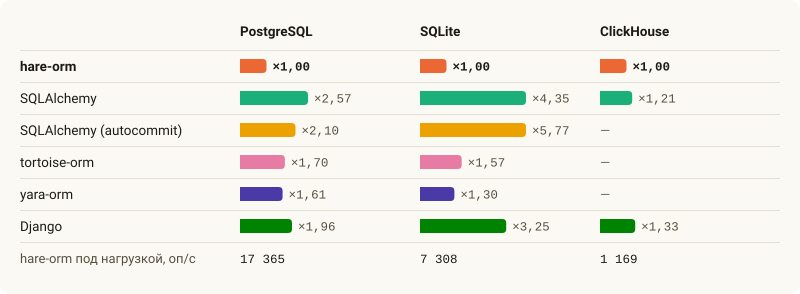

<h1 align="center">
  <picture>
    <source media="(prefers-color-scheme: dark)" srcset="docs/assets/readme-banner-dark.png">
    
  </picture>
</h1>

<p align="center"><a href="README.md">English</a></p>

<p align="center">
  <a href="https://github.com/hare-orm/hare-orm/actions/workflows/ci.yml"></a>
  <a href="https://hare-orm.github.io/hare-orm/ru/"></a>
  <a href="LICENSE"></a>
  <a href="pyproject.toml"></a>
</p>

Асинхронная ORM для Python с PostgreSQL, SQLite и ClickHouse, спроектированная с упором на связи между
моделями. Модели — обычные классы, запросы строятся лениво через `QuerySet`, а миграции создаются по
изменениям моделей. Пришли с Django? См. [Если вы пришли с Django](https://hare-orm.github.io/hare-orm/ru/getting-started/coming-from-django/).

- **Быстрая.** Драйвер PostgreSQL на Rust разбирает строки и преобразует значения вне Python, а
  каждая форма запроса строится один раз: повторный запрос только подставляет новые значения — см.
  [Производительность](#производительность).
- **Связи как надо.** Составные первичные ключи везде — и как цель внешнего ключа, обобщённые связи
  из настоящих внешних ключей, `select_related()`/`prefetch_related()` с условиями, рекурсивные
  запросы по дереву и ошибка вместо незаметно завышенного агрегата — см.
  [Модели и связи](https://hare-orm.github.io/hare-orm/ru/#models-and-relations).
- **Схема — в объявлениях.** Ограничения, частичные индексы и индексы по выражениям, триггеры,
  представления, материализованные представления, функции, последовательности, политики защиты
  строк, права и секционирование описываются в `Meta` модели, а создают и меняют их миграции — см.
  [Схема в `Meta`](https://hare-orm.github.io/hare-orm/ru/#schema-in-meta).
- **Готовые прикладные приёмы.** Мягкое удаление, версии строк, разделение данных по арендаторам (по колонке, по схеме или
  защитой строк в самой базе), оптимистичная блокировка, отслеживание изменённых полей и
  transactional outbox — опции `Meta` — см. [Поведение в `Meta`](https://hare-orm.github.io/hare-orm/ru/#behavior-in-meta).
- **Миграциям можно доверять.** Они выводятся из моделей, проверяются на операции, блокирующие
  нагруженную таблицу, сравниваются с живой базой (`hare drift`) и создаются по существующей базе
  (`hare inspectdb`) — см. [Миграции](https://hare-orm.github.io/hare-orm/ru/#migrations).
- **Каждая база — на своих условиях.** SQLite, PostgreSQL и ClickHouse — диалекты на том же
  публичном API, которым пользуется сторонний пакет; с PostgreSQL приходят его типы, индексы,
  PostGIS, pgvector, полнотекстовый поиск и `LISTEN`/`NOTIFY`, а база без нужной возможности
  отвечает понятной ошибкой вместо неверного результата — см. [Базы данных](https://hare-orm.github.io/hare-orm/ru/#databases).
- **Готова к продакшену.** Наблюдатели, OpenTelemetry, теги в комментариях SQL, детектор N+1,
  метрики пула, распределённые транзакции, реплики для чтения и маршрутизаторы, поддержка PgBouncer,
  схемы Pydantic и интеграции с Litestar, FastAPI и Robyn — см. [Наблюдаемость](https://hare-orm.github.io/hare-orm/ru/#observability).
- **Проверяется до запуска.** Плагин mypy отклоняет опечатку в фильтре и выводит типы строк
  `values()`; плагин pytest, фабрики и проверки числа запросов покрывают тесты — см.
  [Тесты и проверка типов](https://hare-orm.github.io/hare-orm/ru/#testing-and-type-checking).

Полный тур по областям — на [главной странице документации](https://hare-orm.github.io/hare-orm/ru/).

## Содержание

- [Быстрый старт](#быстрый-старт)
- [Установка](#установка)
- [Производительность](#производительность)
- [Документация](#документация)
- [Версии и выпуски](#версии-и-выпуски)
- [Участие в разработке](#участие-в-разработке)
- [Лицензия](#лицензия)

## Быстрый старт

```bash
pip install hare-orm
```

```python
# library/models.py
from hare import fields
from hare.models import Model


class Author(Model):
    id = fields.IntField(primary_key=True)
    name = fields.CharField(max_length=120)


class Book(Model):
    id = fields.IntField(primary_key=True)
    author = fields.ForeignKeyField("models.Author", related_name="books")
    title = fields.CharField(max_length=300)
    rating = fields.IntField(default=0)
```

```python
# main.py
import asyncio

from hare import Hare, HareConfig
from library.models import Author, Book


async def main() -> None:
    await Hare.init(HareConfig.from_db_url("sqlite+aiosqlite://db.sqlite3", {"models": ["library.models"]}))
    await Hare.generate_schemas()

    author = await Author.objects.create(name="Ursula K. Le Guin")
    await Book.objects.create(author=author, title="The Left Hand of Darkness", rating=5)

    async for book in Book.objects.filter(author__name__icontains="le guin").select_related("author"):
        print(book.title, "—", book.author.name)

    await Hare.close_connections()


asyncio.run(main())
```

В настоящем проекте схема ведётся миграциями, а не `generate_schemas()`: `hare makemigrations`, затем
`hare migrate`. См. [Первая модель](https://hare-orm.github.io/hare-orm/ru/getting-started/first-model/).

## Установка

```bash
pip install hare-orm

pip install hare-orm[asyncpg]        # драйвер PostgreSQL на чистом Python вместо драйвера на Rust
pip install hare-orm[clickhouse-connect]  # диалект ClickHouse по HTTP (clickhouse-connect)
pip install hare-orm[clickhouse-driver]   # диалект ClickHouse по родному протоколу поверх TCP (clickhouse-driver)
pip install hare-orm[sqlite-vec]     # векторный поиск в SQLite
pip install hare-orm[encryption]     # EncryptedTextField / EncryptedJSONField (Fernet)
pip install hare-orm[fastapi]        # а также: litestar, robyn, request-query, taskiq
pip install hare-orm[kafka]          # доставка из outbox; а также: rabbitmq, redis, http
pip install hare-orm[opentelemetry]  # спан OpenTelemetry вокруг каждого запроса
pip install hare-orm[pydantic]       # JSONField(field_type=...) и модели pydantic; а также: yaml, faker
pip install hare-orm[pytest]         # плагин pytest; а также: mypy, pyright
pip install hare-orm[ipython]        # `hare shell` с IPython
```

Все дополнения перечислены в разделе
[Установка](https://hare-orm.github.io/hare-orm/ru/getting-started/installation/). Нужен Python
3.12, 3.13 или 3.14.

## Производительность

<!-- benchmarks:start -->
hare-orm против SQLAlchemy, tortoise-orm, yara-orm и Django на PostgreSQL, SQLite и ClickHouse, на
одних и тех же сценариях: во сколько раз каждая ORM в среднем медленнее hare-orm на каждой базе и
сколько операций в секунду выполняет hare-orm под нагрузкой — «на горячую», как работающее
приложение, а не только что запущенное:

<p align="center">
  <picture>
    <source media="(prefers-color-scheme: dark)" srcset="docs/assets/benchmarks/scoreboard-ru-dark.svg">
    
  </picture>
</p>

Все сценарии, машина и версии — на страницах
[Производительность](https://hare-orm.github.io/hare-orm/ru/benchmarks/) документации; сам стенд —
[`benchmarks/bench.py`](benchmarks/README.ru.md).
<!-- benchmarks:end -->

## Документация

**[hare-orm.github.io/hare-orm/ru](https://hare-orm.github.io/hare-orm/ru/)** — полный справочник:
каждый тип поля, опция `Meta`, метод `QuerySet`, операция миграции, средство работы с
транзакциями, возможность диалекта, тип и индекс PostgreSQL и иерархия исключений, на русском и
английском. Если вы впервые знакомитесь с hare-orm,
начните с раздела [Начало работы](https://hare-orm.github.io/hare-orm/ru/getting-started/installation/).

Чтобы собрать и посмотреть её у себя (например, чтобы увидеть ещё не выпущенное изменение):

```bash
poetry install
poetry run mkdocs serve
```

## Версии и выпуски

Номера версий hare-orm следуют [семантическому версионированию](https://semver.org/lang/ru/).
Публичный API — это то, что описано в [документации](https://hare-orm.github.io/hare-orm/ru/);
неописанные имена и имена с ведущим подчёркиванием внутренние и могут измениться в любом выпуске.

До версии 1.0.0 API ещё не устоялся:

- **патч-выпуск** (`0.9.1`) только исправляет ошибки;
- **минорный выпуск** (`0.10.0`) добавляет возможности и может изменить или убрать часть публичного
  API. Каждое такое изменение перечислено в разделе *Breaking changes* записи этого выпуска в
  [CHANGELOG](CHANGELOG.ru.md). Переименованное или убранное имя исчезает в том же выпуске —
  hare-orm не оставляет устаревших псевдонимов.

Начиная с 1.0.0 несовместимые изменения появляются только в мажорных выпусках. Закрепите минорную
версию, с которой вы проверяли своё приложение (`hare-orm>=0.9,<0.10`), и прочитайте журнал
изменений перед переходом на следующую.

Каждый выпуск помечается тегом `vX.Y.Z`, публикуется на [PyPI](https://pypi.org/project/hare-orm/)
и в [GitHub Releases](https://github.com/hare-orm/hare-orm/releases) и описывается в
[CHANGELOG.ru.md](CHANGELOG.ru.md). Текущая работа идёт в ветке `dev`; `main` указывает на последний
выпуск.

### Поддерживаемые версии

| Компонент | Поддерживается |
| --- | --- |
| hare-orm | Последний минорный выпуск; исправления выходят его патч-выпусками |
| Python | CPython 3.12, 3.13, 3.14 |
| SQLite | 3.35.5+ |
| PostgreSQL | 14+ |
| PgBouncer | 1.22.1+ |
| ClickHouse | 25.8+ |
| Redis, RabbitMQ, Kafka (outbox) | 7.2+, 4.0+, 3.9+ |

Полная поддержка обещается только на Linux: базы данных проверяются там. На Windows и macOS hare
ставится и работает для разработки — колёса, CLI и тесты, не читающие базу, проверяются на всех трёх
системах.

Отказ от поддержки версии Python или базы данных — несовместимое изменение, о нём объявляется в
журнале изменений. Исправления уязвимостей выпускаются по правилам [SECURITY.md](SECURITY.ru.md).

## Участие в разработке

Сообщения об ошибках, предложения и пул-реквесты приветствуются. В [CONTRIBUTING](CONTRIBUTING.ru.md)
описаны окружение разработки, набор тестов (SQLite, PostgreSQL через
`asyncpg` и через драйвер на Rust, PgBouncer, ClickHouse), стиль кода, как изменение проверяется и принимается и подпись
(sign-off), которая нужна каждому коммиту.

## Лицензия

MIT — см. [LICENSE](LICENSE). `hare-orm` начиналась как форк Tortoise ORM и содержит
переработанную копию внутреннего построителя запросов PyPika; оба проекта распространяются по
лицензии Apache 2.0. Драйвер PostgreSQL на Rust создан по образцу драйвера
[yara-orm](https://github.com/vsdudakov/yara-orm) — открытой ORM под лицензией MIT — и использует
переработанные части его кода. Обязательные уведомления об авторстве всех трёх проектов собраны в
[NOTICE](NOTICE.ru.md).
